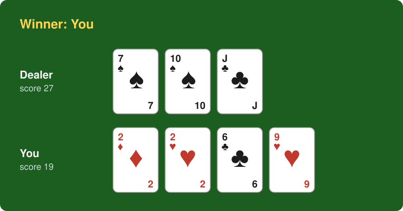

# Blackjack game

A command-line game of blackjack between a player and a dealer, written in TypeScript. The deck is fetched as JSON over HTTP, one round is played, and the result is printed.



## The game

Two players: the Player and the Dealer. One round is played with a deck fetched from a URL.

### Deck

- A deck is a JSON list of card objects, e.g. `{"suit":"HEARTS","value":"5"}`.
- `suit` is one of `HEARTS`, `CLUBS`, `SPADES`, `DIAMONDS`.
- `value` is one of `2`, `3`, `4`, `5`, `6`, `7`, `8`, `9`, `10`, `J`, `Q`, `K`, `A`.
- The deck is fetched with a `GET` from the URL given on the command line. Without a URL it defaults to `https://sandbox.getunleash.io/blackjack/shuffle`.

### Card values

- Face cards (J, Q, K) are worth 10.
- Aces (A) are worth 11.
- Number cards are worth their number.

### Rules

- The Player (named at startup) draws two cards first, then the Dealer draws two.
- Blackjack is 21 with exactly two cards, so it can only happen on the initial draw.
  - If both have blackjack, the Dealer wins.
  - If only one has blackjack, that side wins and the round ends.
  - If neither has it, the round continues.
- The Player draws until reaching 17 or more. A score above 21 is a bust and the Player loses, whatever happens to the Dealer.
- If the Player has not busted, it is the Dealer's turn. The Dealer draws until having a higher score than the Player, or until bust (a score over 21).

### Output

- The winner, prefixed with `Winner:`.
- Then the Dealer's name, score and hand separated with `|`.
- Then the Player's name, score and hand separated with `|`.
- Suits are written as `H`, `S`, `C`, `D`, followed by the card value as received from the deck, so the seven of spades is `S7`.

```
Winner: You
Dealer | 27 | S7,S10,CJ
You | 19 | D2,H2,C6,H9
```

### Examples

Cards are supplied in draw order: the Player's two cards, the Dealer's two cards, then any cards drawn during the round.

Full round, the Dealer busts:

Input deck: `D2,H2,S7,S10,C6,H9,CJ`

```
Winner: You
Dealer | 27 | S7,S10,CJ
You | 19 | D2,H2,C6,H9
```

Player blackjack:

Input deck: `HA,HK,S9,S8`

```
Winner: You
Dealer | 17 | S9,S8
You | 21 | HA,HK
```

Dealer blackjack:

Input deck: `H9,H8,SA,SQ`

```
Winner: Dealer
Dealer | 21 | SA,SQ
You | 17 | H9,H8
```

Both have blackjack. The project rules give the win to the Dealer:

Input deck: `HA,HK,SA,SQ`

```
Winner: Dealer
Dealer | 21 | SA,SQ
You | 21 | HA,HK
```

Player busts:

Input deck: `H10,H6,S2,S3,HK`

```
Winner: Dealer
Dealer | 5 | S2,S3
You | 26 | H10,H6,HK
```

The Dealer busts:

Input deck: `H10,H7,S10,S6,SK`

```
Winner: You
Dealer | 26 | S10,S6,SK
You | 17 | H10,H7
```

## Requirements

[](https://nodejs.org/) [](https://pnpm.io/) [](https://github.com/microsoft/typescript) [](https://github.com/vitejs/vite) [](https://vitest.dev/) [](https://biomejs.dev/)

## Setup

```sh
pnpm install
```

### Development

```sh
pnpm test         # run the tests (vitest)
pnpm typecheck    # type-check with tsc
pnpm build        # bundle to dist/ with vite
pnpm check        # format and lint with biome
pnpm format       # format supported files with biome
```

### Run

```sh
pnpm start                      # uses the default deck URL
pnpm start <deck-url>           # uses the given deck URL
```

The game first asks `Enter your name:`. Your name appears in the `Winner:` line and on your hand's line, in place of the default `You`. The prompt is written to stderr, so stdout holds only the result. If no name is entered (empty line, closed input, or the name "Dealer"), the name defaults to `You`. A `|` in the name is removed.

pnpm prints its own banner before the result; use `pnpm --silent start` or `node dist/main.js` for clean output.

## Logging and observability

All output goes through a `Logger` (`src/logging/logger.ts`), an interface with two methods:

- `info(message)`: the game result. The console logger writes it to stdout.
- `error(message, error?)`: a failure, reported by `handleError`. The console logger writes the message to stderr; the process exits with code 1 for expected errors and 2 for unexpected ones.

To send output to a monitoring tool such as Sentry or Datadog, write an object that implements `Logger`:

```ts
const sentryLogger: Logger = {
  info: (message) => console.log(message),
  error: (message, error) => Sentry.captureException(error ?? message),
};
```

Then use it in the entry point of `src/main.ts`:

```ts
void run({ logger: sentryLogger }).catch((err) => {
  process.exitCode = handleError(err, sentryLogger);
});
```

## Project layout

```
src/
├── main.ts                 # entry point: reads the URL, fetches the deck, plays, prints
├── main.test.ts            # entry-point tests
├── playerName.ts           # asks for and cleans the player's name
├── playerName.test.ts
├── logging/
│   ├── logger.ts            # Logger interface
│   ├── logger.test.ts
│   └── index.ts
├── game/
│   ├── game.ts             # round rules
│   ├── game.test.ts
│   ├── standardBlackjackGame.ts # standard game configuration
│   ├── strategy.ts         # draw strategies
│   ├── strategy.test.ts
│   ├── card.ts             # cards and scoring
│   ├── card.test.ts
│   ├── deck.ts             # deck operations
│   ├── deck.test.ts
│   ├── format.ts           # output formatting
│   └── format.test.ts
├── deckSource/
│   ├── deckSource.ts       # deck-source interface and HTTP fetching
│   ├── deckSource.test.ts
│   ├── deckParser.ts       # response validation
│   └── deckParser.test.ts
├── errors/
│   ├── appErrors.ts         # application error types
│   ├── handleError.ts       # top-level error handling
│   ├── index.ts             # error-module exports
│   └── errors.test.ts       # error-handling tests
└── testing/                 # shared test helpers (cards, HTTP responses, fake logger)
```
